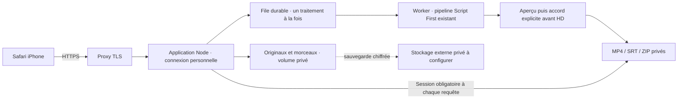

# Atelier web privé pour Safari sur iPhone

L’interface réutilise **Script First, Remotion, l’import audio, le calage local, les ZIP et la validation avant HD**. Elle ajoute une connexion personnelle, des imports par morceaux et une file de traitements serveur. L’ancien atelier `npm run editor` reste un outil local indépendant ; il ne doit pas être exposé tel quel sur Internet.

**État : implémentation testée dans Codex Cloud, aucun hébergement externe déployé et aucune URL accessible depuis un iPhone réel vérifiée.** `127.0.0.1` est l’adresse de la machine cloud, pas une URL utilisable dans Safari sur votre téléphone.

## Proposition d’hébergement réaliste

Pour un compte personnel, commencer avec un serveur persistant en Europe : 4 vCPU, 8 Go de RAM, 80 Go de SSD minimum, Node 24, Chromium et FFmpeg. Un rendu à la fois, deux images calculées en parallèle dans Remotion. Pas de GPU ni de synthèse vocale requis.

| Poste | Ordre de grandeur mensuel |
|---|---:|
| Serveur 4 vCPU / 8 Go | 15–35 € |
| Sauvegarde externe chiffrée | 2–8 € |
| Domaine | 10–20 €/an |
| Stockage objet privé, si ajouté plus tard | Environ 1–3 € pour 50 Go, plus requêtes/sorties selon le fournisseur |

Ces montants sont un **budget indicatif, pas des tarifs fournisseurs vérifiés ni un devis**, hors taxes, licences éventuelles et dépassements. Le stockage objet n’est pas nécessaire à la première version : le volume du serveur constitue le stockage privé. Garder de la place pour les originaux, les morceaux temporaires, les copies de montage et les différentes versions des exports ; prévoir environ trois fois le volume des originaux, puis surveiller l’usage réel. La durée d’un rendu dépend du codec, de la définition et du CPU ; aucune latence garantie.

Une architecture managée avec authentification OIDC, base transactionnelle, file de jobs et stockage S3 privé serait pertinente pour plusieurs utilisateurs. Elle augmente les services à administrer et le coût. **Aucun adaptateur S3, compte OIDC, bucket ou service managé n’est prétendu connecté dans cette version.**



## Ce qui fonctionne ici et ce qui reste à héberger

| Élément | Codex Cloud | Hébergement persistant |
|---|---|---|
| Interface mobile, API, connexion, imports, reprise, checksums | Testables localement | Code réutilisable |
| Worker Remotion/Chromium, aperçus, validation et ZIP | Testables localement | Installer les mêmes dépendances et modèles |
| Disque privé | Session de travail ; conservation entre tâches non garantie | Volume persistant et sauvegarde à configurer |
| Accès Safari depuis le téléphone | **Non vérifié, aucune URL publique créée** | Domaine, DNS, TLS et accès réseau nécessaires |
| Chiffrement du disque et des sauvegardes | Non attesté par l’application | À configurer et vérifier chez l’hébergeur |
| MFA, récupération de compte, multi-utilisateur, S3 | Non implémentés | Extensions futures, pas des capacités acquises |

## Démarrer le prototype dans Codex

```bash
cd /workspace/video-ia/reel
npm_config_cache=/workspace/.npm-cache npm ci --no-audit --no-fund
npm run web:setup
npm run web
```

Le serveur écoute **uniquement sur `127.0.0.1:3300`**. `PORT` peut changer le port. Le setup crée une passphrase aléatoire et son hash scrypt dans `private/web-data/auth/`. Il ne les affiche pas dans les logs. Récupérer `initial-password.txt` **en privé**, conserver la passphrase dans un gestionnaire, puis retirer ce fichier d’amorçage après sauvegarde sûre. Ne jamais copier son contenu dans GitHub, une capture ou un commentaire. Le setup refuse d’écraser des identifiants existants.

`VIDEO_WEB_DATA_DIR` change le dossier privé ; `VIDEO_WEB_ORIGIN` définit l’origine exacte. Une origine HTTP distante est refusée. Avec une origine HTTPS, les cookies sont `Secure`, `HttpOnly`, `SameSite=Strict`; HTTP sans `Secure` est réservé à la boucle locale de développement. Les sessions durent huit heures, sont stockées côté serveur et sont révoquées à la déconnexion ou au changement du hash d’authentification. Les tentatives de connexion sont limitées à cinq par quinze minutes par adresse de connexion. Cette version a **un propriétaire**, sans inscription publique ni récupération de mot de passe par email.

Le backend vérifie l’origine, le token CSRF, la session et les identifiants des ressources. Les originaux, projets, jobs, MP4/SRT/ZIP et requêtes vidéo partielles exigent la connexion. Aucun token de téléchargement n’est placé dans l’URL. Le HTML/JS/CSS de connexion est public ; les fichiers personnels ne le sont pas. Pas de montage statique du dossier privé ni de `file_server` sur les dossiers de Remotion.

## Importer depuis Safari

1. Se connecter à **l’URL HTTPS du service une fois celui-ci réellement hébergé**.
2. Choisir plusieurs vidéos/photos depuis Fichiers ou Photos, puis éventuellement un WAV/MP3 exporté d’ElevenLabs. Aucune API ElevenLabs ni synthèse n’est appelée.
3. Garder Safari ouvert pendant les transferts. La progression distingue calcul d’empreinte, transfert et vérification intégrale côté serveur. Chaque original vérifié peut être retéléchargé.
4. Saisir le sujet, le texte exact, le modèle et la durée 15/30/60. Le script peut être enregistré avant l’arrivée des médias. Cocher les images dans l’ordre voulu et sélectionner la piste ou « Sans voix ».
5. Valider le script et autoriser les **copies de travail** nécessaires au montage. Les originaux ne sont jamais modifiés. Sans cet accord, l’enregistrement du projet reste possible mais le rendu est bloqué.
6. Préparer l’aperçu 720 × 1280, consulter son statut et récupérer le MP4, le SRT et le ZIP privé. Sans voix, le SRT est provisoire ; l’accord concerne uniquement le montage et n’exporte pas la HD.
7. Ajouter la voix ensuite si nécessaire : une nouvelle révision et un nouvel aperçu sont requis. Après visionnage et écoute, valider explicitement cette version pour la HD.

**iOS peut convertir un média avant de le remettre au navigateur via Photos.** L’application garantit la conservation exacte des octets reçus, pas l’identité avec le fichier maître inaccessible de la photothèque. Pour conserver et resélectionner le même original, privilégier un export dans **Fichiers**. L’application n’effectue aucune compression ni conversion côté navigateur pendant l’upload.

Safari peut suspendre les requêtes quand le téléphone est verrouillé ou l’application en arrière-plan. Il n’y a **aucune promesse d’upload en arrière-plan**. Une reconnexion puis la sélection du même fichier permettent la reprise. Après un rechargement, iOS ne permet pas de réutiliser automatiquement un ancien objet `File` : le fichier doit être resélectionné. Les octets déjà acceptés restent sur le serveur.

## Protocole des gros fichiers et intégrité

- Limites actuelles : **2 Gio par original**, morceaux **8 Mio**, quota de réservation des originaux/imports **10 Gio**, réserve disque **1 Gio**. Les tests peuvent employer de plus petites limites ; elles ne sont pas modifiables par une requête navigateur.
- SHA-256 intégral calculé **incrémentalement** par `@noble/hashes`, sans charger le fichier entier en RAM. Les noms et identifiants de reprise peuvent être conservés en IndexedDB ; le serveur est l’autorité et conserve les parties même si le navigateur perd ce cache. Aucune voix ou vidéo entière n’est placée dans IndexedDB.
- Chaque `PUT` de morceau porte son SHA-256 ; taille et hash sont vérifiés avant acceptation. Une retransmission identique est idempotente ; un contenu différent sur un index accepté est refusé. Une requête coupée n’est pas enregistrée comme complète.
- À la finalisation, les morceaux sont relus, leurs empreintes revérifiées et l’empreinte complète comparée à celle du navigateur. Un morceau altéré sur disque est invalidé et doit être renvoyé. Aucune ressource exploitable n’est publiée en cas d’échec.
- Le fichier final est stocké sous un identifiant opaque avec des permissions privées, sans nom utilisateur dans les chemins techniques. La copie assemblée devient l’original immuable ; les morceaux sont ensuite supprimés. Une nouvelle demande avec le même fichier complet réutilise son original vérifié.
- Le quota réserve la taille complète des imports incomplets avant réception. L’espace libre est vérifié à l’ouverture et avant assemblage. L’utilisateur peut annuler les morceaux d’un import incomplet ; cette action ne supprime pas un original déjà vérifié. Les originaux complets ne sont pas effacés automatiquement.

L’API est un protocole de morceaux propre à cette application, **pas une implémentation annoncée du standard tus**. Une seule instance du backend détient le verrou du dossier privé ; ce stockage JSON/fichiers n’est pas conçu pour plusieurs serveurs concurrents.

## Traitement existant et limites de formats

La file durable démarre un processus Node séparé qui appelle `runProduction`. Les identifiants de jobs dépendent de la révision et de l’identité du pipeline, ce qui évite les doubles exports. Les mots de passe/sessions du serveur ne sont pas transmis dans l’environnement du worker. Les originaux sont seulement lus. Les copies FFmpeg et les rendus sont des fichiers distincts, comme dans le pipeline existant.

Le worker utilise `VIDEO_IA_MAX_MEDIA_BYTES=2147483648`; le CLI historique conserve sa limite de 500 Mio par défaut. Le hash de l’import média a été rendu incrémental pour éviter un buffer géant. Les fichiers locaux sont les seuls protocoles autorisés au précontrôle média. Les sorties du worker utilisent `VIDEO_IA_RUNS_DIR` dans le dossier de données privé.

Le pipeline reste limité à **10 minutes par vidéo/audio**. Les originaux plus longs peuvent être stockés, mais le rendu est refusé avec un diagnostic ; aucun tronquage silencieux n’est ajouté. HEIC/HEIF sont conservés mais ne sont pas montables dans cette version. JPEG/PNG/WebP, MOV/MP4/M4V/WebM/MKV, WAV/MP3 sont les entrées proposées. La conversion HEVC/HDR et la colorimétrie des vraies vidéos iPhone doivent être contrôlées sur un aperçu ; aucune validation de toutes les variantes iOS n’est revendiquée.

Un échec de worker est enregistré ; « Reprendre » relance la même configuration et réutilise les checkpoints. Au redémarrage du backend, les jobs en cours sont marqués interrompus plutôt que prétendus réussis ; les jobs en attente reprennent leur file. Le projet modifié ne peut pas approuver un ancien aperçu, et l’accord sans voix ne vaut jamais accord HD.

L’alignement de la voix utilise le modèle français local déjà documenté. Fournir le transcript effectivement prononcé. Les mots inconnus demandent une prononciation vérifiée ; aucune voix ni synchronisation de remplacement n’est inventée.

## Héberger ensuite — préparation, pas déploiement exécuté

Les exemples `reel/deploy/` sont des **modèles à adapter et à vérifier sur le serveur choisi**, pas une installation validée. Aucun domaine, certificat, compte fournisseur, sauvegarde ou service systemd n’a été créé par cette tâche.

Prévoir :

1. Un compte système dédié non privilégié, un volume persistant privé, le code et ses dépendances verrouillées. Installer Node 24, FFmpeg, Chromium et l’aligneur local. Garder le dossier de données, les caches nécessaires et les copies de travail persistants ; ne pas utiliser une commande de nettoyage qui efface les dossiers ignorés.
2. Un domaine appartenant à l’utilisateur, DNS, proxy TLS et certificat valide. Le backend reste lié à la boucle locale ; seuls HTTPS et l’administration restreinte doivent entrer sur le serveur. Ne pas exposer les anciens ports Studio/editor ni les serveurs internes de Remotion.
3. `VIDEO_WEB_DATA_DIR=/srv/video-ia-data` et `VIDEO_WEB_ORIGIN=https://votre-domaine`. Exécuter le setup privé sous le compte du service. Ne pas ajouter de hash, mot de passe ou clé au dépôt.
4. Sauvegarde **chiffrée** et privée du dossier de données, politique de conservation et test de restauration. Le chiffrement du volume, les quotas réels, le remplissage du disque et les accès opérateurs sont à vérifier chez l’hébergeur. La présente application ne chiffre pas elle-même les fichiers au repos.
5. Vérifier depuis un **vrai iPhone extérieur au réseau du serveur** : login HTTPS, choix de fichiers, transfert, mise en veille/interruption, resélection/reprise, lecture vidéo avec requêtes partielles et enregistrement MP4/ZIP dans Fichiers. Essayer aussi les liens sans session : refus attendu. Ce n’est qu’après ces vérifications qu’une URL peut être annoncée utilisable sur iPhone.

Pour un accès partagé ou une exposition plus large, ajouter une authentification avec MFA/OIDC, une base transactionnelle, une séparation des propriétaires et une revue de sécurité du déploiement. Ces fonctions ne sont pas simulées dans le prototype personnel.

## Commandes de contrôle

```bash
npm run typecheck
npm test
# Contrôles ciblés, sans média personnel :
node --test tests/web.test.mjs
node --test tests/web-browser.test.mjs
```

La suite API contrôle connexion/CSRF/refus anonyme, limites de login, coupure réseau réelle, redémarrage avec reprise des morceaux, SHA-256 partiel/intégral, corruption disque, doublons, quotas et sessions nécessaires aux téléchargements. Le test navigateur mobile utilise une **mire synthétique avec une zone QuickTime `free`**, valide et supérieure à 500 Mio, pour tester un vrai gros import sans vidéo personnelle. Il conserve les octets originaux, effectue un vrai aperçu Script First, télécharge MP4/ZIP et valide uniquement le montage de cette fixture sans déclencher la HD.

Ce test est exécuté dans **Chromium avec viewport mobile**, pas dans Safari sur un iPhone physique. L’upload audio y utilise un signal non verbal pour tester le transfert, jamais présenté comme une voix ElevenLabs. Les rendus HD et la fidélité vocale du pipeline restent couverts par ses tests et vérifications existants ; aucune exécution du service ElevenLabs n’est revendiquée.

Résultats dans cet environnement : **TypeScript valide et 52 tests réussis**, aucun échec ni test ignoré. Le parcours mobile a importé une photo, un MOV de **501 Mio** et un WAV de test, vérifié les octets de l’original après rendu, généré un vrai aperçu de 15 s en 720 × 1280, puis téléchargé MP4 et ZIP. L’accord sur cette fixture sans voix laisse la HD bloquée. Les tests API ont également vérifié une connexion réellement coupée suivie d’un redémarrage du serveur et d’une reprise, ainsi que le refus des accès anonymes aux originaux et aux exports. **La limite configurée de 2 Gio n’est pas présentée comme un transfert de 2 Gio testé sur iPhone.**

Le parcours navigateur a ensuite été rejoué avec une interruption du MOV de 501 Mio, rechargement complet de la page et resélection du même fichier : reprise réussie, sans retransmettre son premier morceau déjà accepté. Les contrôles API ciblés ont également été rejoués après les ajustements des en-têtes de téléchargement et du calcul de réservation du quota.
